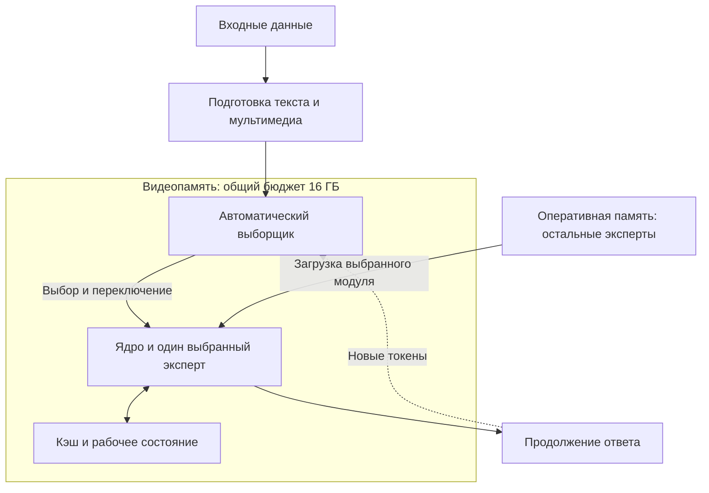

# Нейросеть, которую можно развивать сообща

Представьте: открытая нейросеть на вашем домашнем компьютере соперничает по качеству с большими закрытыми моделями. Её способности растут благодаря участникам, которые развивают отдельные специализации и пользуются результатами друг друга.

Такова цель открытой модульной нейросети: объединить труд независимых участников, каждый из которых совершенствует свою область. Сравнительно небольшая организация могла бы начать этот проект — выпустить полезную общую основу и дать другим возможность добавлять совместимые специализации. По мере их развития росли бы и способности всей системы.

В её библиотеке могли бы соседствовать программист-универсал, специалисты по Python и Go, системный администратор, математик, редактор, художник. Пользователь устанавливает нужных ему экспертов, а система сама определяет, когда кого применять. Общий разговор и задачи, для которых нет подходящего специалиста, берёт на себя универсальный компонент.

Например, вы просите подготовить небольшой сервис. Программист-универсал помогает разобрать задачу, эксперт по Python пишет программу, системный администратор подключается при настройке сервера. В другой работе могут понадобиться математик и специалист по Go. Система сама выбирает подходящих исполнителей, а после переключения они продолжают общую работу, сохраняя требования и промежуточные результаты.

Для пользователя это возможность собрать систему под свои занятия. Для разработчика эксперта — сосредоточиться на том, в чём он разбирается лучше всего. Научная группа может заниматься своей дисциплиной, команда программистов — языком или классом задач, издательство — работой с текстом. Участнику не нужно создавать всю универсальную модель, чтобы внести полезный вклад.

## Общая основа, разные участники

Такой проект можно назвать народной нейросетью. Участвовать в нём можно и как пользователь, и как разработчик отдельной специализации. Важны обе стороны доступности: возможность запускать систему на сравнительно небольших ресурсах и возможность развивать её по частям.

Ориентир по масштабу применения даёт Linux. Его ядро лежит в основе [Android](https://developer.android.com/guide/platform/index.html), для которой Google в мае 2025 года указывала [более трёх миллиардов активных устройств](https://blog.google/products-and-platforms/platforms/android/the-android-show-io-2025/). Семейство Linux используется и на [суперкомпьютерах списка TOP500](https://www.top500.org/statistics/details/osfam/1/). Общая открытая основа может пригодиться владельцу массового устройства и организации с огромными вычислительными ресурсами.

Для модульной нейросети нужен такой же охват: домашний компьютер, рабочая станция, сервер предприятия, большой вычислительный комплекс. Участники выбирают оборудование и набор модулей под свои задачи, сохраняя возможность развивать общую основу.

Первый выпуск должен быть полезен ещё до появления большого сообщества. Организация-инициатор готовит универсальный компонент, автоматический выборщик, средства мультимодальности и 5–10 доменных экспертов. Под доменом здесь понимается область знаний или круг задач: программирование вообще, работа с отдельным языком, администрирование, редактирование текста. Вместе с системой выходят инструменты и правила, по которым другие смогут обучать свои модули.

Затем участники развивают отдельные специализации. Одна команда выпускает улучшенного эксперта по Python, другая — по Go, третья совершенствует системного администратора. Пользователь обновляет нужные модули. Библиотека может вырасти до сотен и тысяч экспертов, а на конкретном компьютере останется лишь выбранный комплект.

Как и в случае с Linux, общая основа могла бы заинтересовать и крупные компании. Компания поддерживает компоненты, которыми пользуется сама; другие участники направляют усилия на свои специализации. Общие части при этом нуждаются в постоянном сопровождении и финансировании.

## Почему это будет быстро работать на домашнем компьютере

Во время работы в быстрой памяти находятся универсальные компоненты и один выбранный эксперт. Остальные установленные модули ожидают в оперативной памяти компьютера; более широкая библиотека может храниться на накопителе. Пользователю не требуется загружать в видеопамять всё, что создано сообществом.

Выбранный специалист работает над фрагментом ответа, несколькими сообщениями или всей беседой. Когда задача меняется, система подключает другого. Эксперт после загрузки долго остаётся в видеопамяти, поэтому его веса не приходится постоянно переносить между хранилищем и вычислителями. Это резко сокращает объём пересылок и делает такую систему значительно быстрее гигантской плотной модели, которая вынуждена постоянно подгружать веса из оперативной памяти.

Для первой реализации предлагается бюджет в 16 ГБ видеопамяти на весь активный набор: универсальные компоненты, выборщик, одного эксперта, кэш и рабочие данные. Для домашнего компьютера с RTX 5070 Ti расчётный ориентир — **40–80 токенов в секунду**, то есть около 13–25 секунд на генерацию 1000 токенов после обработки запроса и загрузки нужного эксперта. Условия расчёта приведены в техническом разделе.

Доменный эксперт может содержать миллиарды параметров и быть сопоставимым по размеру с универсальным компонентом. Вся библиотека со временем сможет насчитывать триллионы параметров, а в текущей работе будет участвовать только нужная специализация.

Такая архитектура соединяет большой запас специализаций с небольшим активным набором. Независимые команды совершенствуют данные и обучение своих экспертов, а пользователь получает их способности на доступном оборудовании.

## Как сделать так, чтобы вклады складывались

Участникам понадобится больше, чем инструкция по обучению. Нужны опубликованные правила совместимости, поддерживаемые версии общей основы, описание возможностей каждого эксперта и способ проверить его качество. Название «математик» или «программист» должно сопровождаться сведениями об авторе, назначении и результатах проверок.

Особенно важен путь подключения новых модулей. Выборщик должен получать возможность распознавать задачи, в которых полезен новый эксперт. Подключение по опубликованным правилам позволит участникам пополнять библиотеку без персональной доработки всей системы центральной командой.

Обновления общей основы также должны учитывать труд, уже вложенный в специализации. Без устойчивых правил совместимости участник рискует потерять результат своей работы при смене версии. Поэтому сопровождение платформы — такая же часть замысла, как обучение моделей.

Первой проверкой идеи могло бы стать сотрудничество нескольких независимых команд. Каждая обучает своего эксперта по опубликованным правилам. Затем другая организация собирает из этих модулей полезный комплект: система автоматически применяет новые способности и продолжает работать после обновлений.

Такое сотрудничество станет основой для расширения проекта. Начать его может сравнительно небольшая организация, а дальнейшее развитие станет общим делом. Каждый участник совершенствует свою область, пользуясь результатами других. Из этой совместной работы и вырастет открытая система, способная соперничать с большими корпоративными моделями.

## Техническое устройство и целевые параметры

Универсальную часть можно организовать двумя способами:

1. Небольшая плотная модель служит постоянным ядром. Эксперты подключаются к ней и специализируют вычисления.
2. Автоматический выборщик направляет задачу одному из исполнителей. Среди них есть нулевой эксперт, обученный на всём корпусе проекта: универсальный исполнитель на случай, когда нет лучшего специалиста. Перед исполнителями может находиться небольшое общее ядро.

В обоих вариантах отсутствие нужного модуля не останавливает работу: запрос выполняет универсальное ядро или нулевой эксперт.

Эксперт может содержать миллиарды параметров; предложение не ограничивается небольшими адаптерами LoRA — методом экономного дообучения. Существенны возможность отдельного развития, совместимость с общей системой и способность выполнять определённый круг задач.

Для первой реализации предлагается выбрать целевую платформу инференса — выполнения уже обученной системы — с **16 ГБ видеопамяти суммарно на ядро, выборщик, одного активного эксперта и кэш**. Остальные установленные эксперты находятся в общей оперативной памяти компьютера и переносятся в видеопамять при необходимости. Размеры моделей и режим выполнения подбираются под этот бюджет.

| Элемент | Назначение и размещение |
|---|---|
| Общее ядро | Универсальная основа в первом варианте; возможный небольшой общий компонент во втором. Учитывается в бюджете видеопамяти |
| Выборщик | Классифицирует доступный поток, определяет эксперта и момент переключения. Находится в видеопамяти |
| Активный эксперт | Один выбранный доменный модуль; может содержать миллиарды параметров. Находится в видеопамяти |
| Кэш и рабочие буферы | Состояние контекста, включая KV-кэш — сохранённые ключи и значения внимания, если выбранная архитектура его использует, — и промежуточные данные вычислений. Учитываются в тех же 16 ГБ |
| Остальные эксперты | Хранятся в оперативной памяти; объём требуемой памяти зависит от состава библиотеки |
| Мультимодальные компоненты | Обрабатывают изображения, звук и другие поддерживаемые входы. Их размещение нужно определить, а потребление видеопамяти также включить в общий бюджет |

Логическая схема исполнения:

Схема показывает размещение и управление; точные нейросетевые связи зависят от варианта архитектуры. В варианте с нулевым экспертом он занимает место выбранного исполнителя, когда нет лучшего специалиста. Одновременно держать в видеопамяти нулевого и специализированного эксперта не предполагается. Если используется постоянное универсальное ядро, оно обеспечивает самостоятельную работу при отсутствии специального модуля.

В бюджет входят все размещённые на ГПУ веса, кэши и служебные данные. Размер моделей выбирается с учётом способа хранения весов, длины контекста, мультимодальности и затрат исполнения. Бюджет 16 ГБ относится к инференсу; требования к обучению определяются отдельно.

Начать можно с **5–10 экспертов**. Например: программист-универсал, специалисты по Python и Go, системный администратор, математик, редактор, художник и специалист по разговору с идиотами. В варианте с нулевым экспертом его также нужно предусмотреть в стартовом комплекте. Перечень показывает принцип отбора: домен может определяться и областью знаний, и характером деятельности.

Порядок подготовки системы:

1. Обучить универсальное ядро или нулевого эксперта на всём выбранном корпусе.
2. Подготовить исходную классификацию данных и обучить автоматический классификатор.
3. Применить классификатор к корпусу и направить материал на обучение соответствующих доменных экспертов.
4. Обучить экспертов и подготовить систему к продолжению работы со смешанной историей после переключений.
5. Использовать тот же классификатор как выборщик при инференсе.

Во время генерации выборщик получает весь доступный поток, но сохраняет текущего эксперта, пока тот подходит задаче. Он может предложить несколько кандидатов в порядке предпочтения. Загружается выбранный доступный модуль. Переключение возможно внутри одного ответа; длительность работы каждого эксперта определяется развитием задачи.

После переключения сохраняются текстовая история и необходимые результаты работы. Выбранная архитектура и обучение должны обеспечивать совместимость внутренних состояний и подготовку кэша для нового эксперта.

Например, выборщик может определить: для текущего фрагмента лучше эксперт А, при его отсутствии подходит Б, запасной вариант — В. Если ни одного подходящего модуля нет, работу продолжает универсальный компонент. То же правило действует при появлении пользовательских экспертов: система получает возможность распознавать задачи, в которых полезен новый модуль, через обновление классификатора или его связи с библиотекой.

### Оценка скорости на RTX 5070 Ti

Для конфигурации с 16 ГБ подходит **GeForce RTX 5070 Ti**. У обычной RTX 5070 — 12 ГБ видеопамяти. [Характеристики NVIDIA](https://www.nvidia.com/en-us/geforce/graphics-cards/50-series/rtx-5070-family/).

Практический ориентир даёт опубликованный тест llama.cpp: RTX 5070 Ti генерирует **176,85 токена/с** на Llama 2 7B с четырёхбитными весами Q4_0, полностью размещёнными на ГПУ. Это результат теста генерации 128 токенов с CUDA и без Flash Attention. [Таблица результатов llama.cpp](https://github.com/ggml-org/llama.cpp/discussions/15013).

Для предлагаемой системы возьмём более крупный активный набор: 8–12 ГБ четырёхбитных весов универсальных компонентов и одного эксперта. Остальная видеопамять отводится под кэш и рабочие данные. Расчётный режим — один текстовый запрос, контекст до 4096 токенов, уже загруженный эксперт. При эффективном чтении весов со скоростью 480–640 ГБ/с получаем:

| Активные веса | Расчётная скорость генерации |
|---|---|
| 8 ГБ | 60–80 токенов/с |
| 10 ГБ | 48–64 токена/с |
| 12 ГБ | 40–53 токена/с |

Оценка получена делением эффективной скорости чтения весов на их активный объём. Диапазон 480–640 ГБ/с — расчётное допущение с запасом относительно приведённого теста. Таким образом, ориентир для этой конфигурации — **40–80 токенов/с**, или около **13–25 секунд на 1000 токенов**. Это время генерации текста после обработки запроса и загрузки эксперта; эти две операции учитываются отдельно.

### Отличие от частой экспертной маршрутизации

Исходной точкой послужили архитектуры Mixture of Experts — смеси экспертов, или MoE. В типичной разреженной MoE выбор выполняется для отдельных токенов в экспертных слоях. Даже один выбранный эксперт на слой не устраняет возможность частой смены используемых весов по ходу генерации. В некоторых архитектурах, например Switch Transformer, при обучении дополнительно выравнивают использование экспертов. Это балансировка обучающей нагрузки, а не требование задействовать всех экспертов в каждом разговоре. [Switch Transformer](https://arxiv.org/html/2101.03961v3).

В предлагаемой системе целостная доменная специализация работает на продолжительном участке. Математик и программист могут сменять друг друга при разработке программы для физического эксперимента. Остальные домены остаются вне активного набора. Преимущество связано с длительностью работы эксперта и редкой загрузкой других модулей.

Крупный эксперт после загрузки долго используется в видеопамяти. Остальная библиотека не участвует в каждом следующем вычислении и не требует постоянной передачи на ГПУ. При смене эксперта освобождается место для нового модуля.

По сравнению с запуском на том же оборудовании гигантской плотной модели, не помещающейся в видеопамять, такая организация резко сокращает объём регулярно перемещаемых весов. Даже если все эксперты вместе занимают больше места, чем эта модель, для текущего продолжения требуется лишь небольшой по отношению к библиотеке активный набор. Поэтому библиотека может быть огромной, а генерация — быстрой: на каждом шаге работает только загруженная специализация.

Для добавления новой специализации участник должен получить инструменты обучения, правила совместимости с ядром и мультимодальными компонентами, формат описания эксперта и процедуру включения в автоматический выбор. Размер библиотеки может расти независимо от объёма активного набора, пока сохраняется возможность загрузить нужный модуль и выполнить задачу в заданном бюджете.

### Технические предшественники

У предложения есть технические предшественники. В [DEMix](https://aclanthology.org/2022.naacl-main.407/) исследуются явные доменные эксперты и расширение их набора. [MoCLE](https://arxiv.org/html/2312.12379v2) использует предварительную кластеризацию инструкций для экспертной маршрутизации. [MeteoRA](https://arxiv.org/html/2405.13053v3) рассматривает автоматический выбор готовых адаптеров в ходе вывода. Эти работы помогают понять, какие механизмы уже доступны. Предлагаемая организационная задача — связать обучение, подключение и автоматическое применение независимо развиваемых крупных модулей в устойчивую общую платформу.
